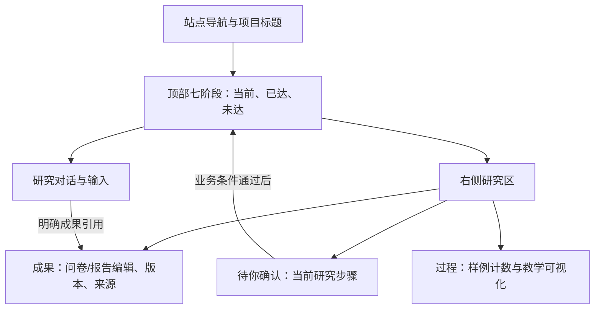

# A 方案：全站数模演易布局，迁入市调业务内核

日期：2026-10-19。状态：待评审的比较方案；用户要求与 B 同时准备，本文件不代表选定 A，也不授权实施。

## 1. 要实现的结果

用户从数模演易式首页、案例列表和详情进入研究；项目内继续采用其“顶部进度＋项目切换＋对话＋右侧确认/成果/过程”组织。
研究内容与完成条件全部替换为拒绝脑补的市调七阶段。全站雾蓝，品牌名称和已有市调材料保留。

与 B 的唯一战略差异是工作台交互重新排布：A 不保留常驻的左侧七阶段研究栏，七阶段入口放在顶部；项目切换栏可以收起。它不是把数学建模界面文案简单改名，也不是继续运行两个前端应用。

## 2. 判断依据与成本

| 事实/判断 | 依据或后果 |
| --- | --- |
| scdc 已有整站与工作台 DOM 结构 | `src/views/PrototypeShell.vue`、`src/styles/prototype.scss` |
| 它的工作台右栏实际包含待确认、产物、演示 | 本地模板读取；尚未在本轮运行浏览器验证 |
| 原型 B 业务不是独立可插拔内核 | `src/app.js` 同时处理 DOM、状态、存储、修订和导出 |
| A 可获得更统一的整站布局 | 设计判断，需要相同任务的真实页面验证 |
| A 的主要额外成本是编辑/确认/导航重排 | 29题问卷、长报告、版本与来源返回都要重新安排位置，不能用普通文本预览代替编辑器 |

不复用 scdc 的数学建模阶段、不保留其默认管理员、不把其会话 HTML 快照当市调项目数据库、不运行旧 port 生成脚本。

## 3. 共用依据

- [共同业务与服务契约](../../frontend/shared-contracts.md)：类型、内核、存储、导入、服务、运行事件和共同路由。
- [共同视觉约束](../../../DESIGN.md)：雾蓝、字体、文字优先和桌面基准。
- [验收矩阵](../../frontend/acceptance-matrix.json)：AC01—AC28 共同场景及 A01—A04 专项。
- [来源指纹](../../frontend/source-baseline.json)：归档提交、参考文件哈希与证据级别。

共同约束：品牌名称固定为“拒绝脑补”，全站采用雾蓝。七阶段业务规则来自原型归档，数学建模逐问求解流程不进入市调状态机。
对话卡、预览、版本列表、全屏和下载绑定同一 projectId + artifactId + versionId。
草稿、已保存待确认、已采用、历史与需重新核对分开表示。
真实服务失败不得静默切换为模拟成功。

## 4. 页面与主要动作

| 页面 | 借用的外壳结构 | 市调落点与完成条件 |
| --- | --- | --- |
| 首页 | 顶栏、研究输入、精选案例、筛选入口 | 输入研究方向或选择明确教学案例；未知背景允许留待核实；无真实模型时不声称已智能理解 |
| 案例列表 | 分类、卡片、筛选和空状态 | 公开介绍与完整观演演练分区，10条公开介绍不冒充全文 |
| 案例详情 | 顶部摘要、材料页签和进入动作 | 公开资料/研究过程/材料/可用演练；没有内容的页签解释缺项，不编造 |
| 我的项目 | 任务列表式项目切换与继续 | 显示保存时间、模式、当前阶段；不把模拟项目显示成真实调查完成 |
| 我的成果 | 成果卡与项目筛选 | 按有效成果种类统计，精确打开指定版本 |
| 研究工作台 | 顶部七阶段、对话、右侧三页签 | 以同一项目状态驱动待确认、完整编辑、预览和过程 |

外壳上的品牌、赛题示例、按钮和空状态均使用市调语义；不保留“求解器”“运行数学建模代码”等不适用词。

## 5. 工作台结构

- `AWorkbenchLayout.vue` 管布局，不拥有项目副本。
- `TopStageNavigator.vue` 只允许进入已到达阶段；回看与恢复编辑是不同动作。1280宽时可显示当前阶段和完整阶段菜单，不能截掉后面的阶段名。
- `ProjectSwitcher.vue` 管项目导航；打开切换面板不改研究进度。切换时先保留草稿、取消本轮演示并清理旧 UI 焦点。
- `ResearchChat.vue` 显示当前推荐动作、消息和精确成果卡；历史动作不重复提交。
- `ResearchRail.vue` 管 `confirm | artifact | process` 三个区域；切换仅改变 UI，不保存、不采用、不推进阶段。
- `ArtifactWorkspace.vue` 内承载真正的问卷/报告/数据编辑组件；编辑器支持专注层，返回保留草稿和滚动位置。

右栏是研究工作区，不是只读文件浏览器。来源表、长问卷和报告目录有专用组件，不把所有内容塞入通用 HTML 字符串。

## 6. 确认与编辑协作

界面称“待你确认”，不向学生显示工程术语“闸门”。
`ConfirmationPanel.vue` 的确认对象绑定 `{ projectId, stage, baseRevision, inputSignature }`，由 canAdvance 和当前保存结果推导。

1. 对话里的下一步首先定位对应确认项；真正推进的主要按钮只在一个有效确认位置出现。
2. 当前编辑存在未保存改动时，提示先保存或返回修改；不能绕过草稿直接确认旧正文。
3. 保存成功后生成新的保存版，更新待确认引用；采用由明确确认触发。
4. 旧确认项保留只读结果，不可再次提交。上游内容改动后，旧 inputSignature 的确认失效。
5. 历史成果卡只打开原版本，不刷新为“最新”；返回当前任务不丢待保存正文。

前端演示确认和未来服务器 HITL 通过服务适配区分，不将本地点击认作服务端已恢复运行。

## 7. 七阶段内容进入右栏的方式

| 阶段 | 右栏主内容 | 确认依据 |
| --- | --- | --- |
| 赛事理解 | 背景、届次组别、来源和未知项 | 已知/待核实分列；不得自动宣称当届 AI 规则已核实 |
| 选题分析 | 题目、对象、地点、时间与研究目的 | 用户保存的选题和背景 |
| 研究方案 | 可编辑方案、问题—测量—题目映射 | 方案保存且必要字段可见 |
| 问卷预测试 | 逐题编辑、29题目录、受访者预览、反馈 | 题目有效；反馈对应当前问卷签名 |
| 正式调查 | 原件保管、明确样例、字段含义和处理决定 | 未解析原件不当答卷；样例字段/处理明确确认 |
| 数据分析 | 分母、图表、行记录、视角、运行演示 | 本次结果可核对；取消/失败不冒充成功 |
| 报告与答辩 | 正文、目录、修订、版本、来源、下载 | 保存稿与采用稿可区分；真实研究与演练结尾分开 |

## 8. 数据流与服务模式

`View -> store action -> engine candidate -> Repository transaction -> committed project -> all views`。
对话只是动作入口之一；任何按钮、快捷选项和以后模型建议都经过相同业务检查。
三页签不得分别缓存三份可编辑正文。Repository 负责持久化；RunGateway 负责运行事件，两者不绑具体后端。
本轮默认 local repository + explicit demo gateway。切到未接通的 remote 服务必须显示不可用，不自动降级模拟。

## 9. 迁移方式

先建立共同工程和业务内核，再移植外层页面，再实现 A 工作台，再接问卷、样例分析、报告与导出。
优先移植 workflow/questionnaire/experience 等规则和测试意图；app.js 中的渲染函数按 Vue 组件重做，React entry.tsx 仅作行为来源。
scdc 的 API 客户端机制先提炼为接口适配设计；实际选定服务后再实现真实协议，不因现有 Java 地址写在注释里就接入它。
旧备份仅由用户显式导入新项目，原站点记录不被读取或覆盖。新项目默认静态 HTTP 交付，旧离线入口保持可用。

## 10. 质量、风险与退出条件

| 风险 | 必须检查的结果 |
| --- | --- |
| 右栏同时承载确认和长编辑 | 在1280×720能定位正文、保存和确认；不在页签之间丢草稿 |
| 顶部阶段与右侧确认错位 | 改上游后所有旧确认失效；未到达阶段不能从顶部绕过 |
| 迁移只保留外观 | 问卷搜索/结构操作、来源返回、版本、备份和导出均有行为验收 |
| 确认泛化为任意服务表单 | 市调阶段完成依旧由业务规则决定；模型输出不直接推进 |

进入实施前：用户审阅本方案与 A 计划，并选定 A；技术首任务完成依赖与构建小样。
完成前端迁移：AC01—AC28及A01—A04均有新版本实际证据；没有遗漏高风险行为，下载与保存版本一致。
真实后端联调、手机完整流程、新单文件离线分享和真实学生试用分别验收，不打包成已经完成。

## 11. 为什么可能选择 A

如果优先目标是整站布局的一致性，并愿意重新验证右侧确认与长编辑的可用性，A 更符合目标。
不能仅凭复用页面数量推断 A 更省时间；业务适配与重新组织编辑流程是主要未知成本。

实施文件、依赖顺序和检查见 [A 前端开发计划](../plans/2026-10-19-A-前端开发计划.md)。
