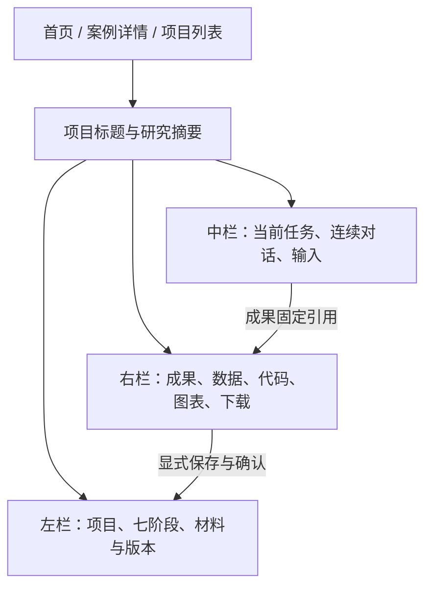

# B 方案：数模演易站点外壳，保留三栏市调工作台

日期：2026-10-19。状态：待评审的比较方案；用户先前偏向 B，最新要求 A/B 各配方案和计划，尚未授权实施。

## 1. 要实现的结果

首页、列表、详情、我的项目与我的成果借用数模演易的站点版式，全部换成拒绝脑补的市调内容和雾蓝品牌。
进入项目后保留现有“左侧项目与七阶段、中间研究对话、右侧研究成果”的工作方式。
页面实现统一迁为 Vue 工程，业务规则、编辑语义和成果身份延续归档 B 版。

本方案的“保留”指保留行为和信息分区，不是把现有 React 应用直接嵌入 Vue，也不承诺逐像素保留所有历史 CSS。

## 2. 判断依据与成本

| 事实/判断 | 依据或后果 |
| --- | --- |
| B 版已有三栏、逐题编辑、报告定位与专注模式 | 归档源码及已保存的桌面验证记录 |
| 用户明确选过三栏保留和全站雾蓝 | 本次结构化回答；随后要求两案比较 |
| Vue 化仍需要拆开渲染、事件和持久化 | B 版 app.js/entry.tsx 的职责交织；不能仅改文件后缀 |
| B 的交互迁移风险相对更可控 | 设计判断：可按现有动作做对照，但没有本次实测工期证明 |
| 接入共同站点外壳仍存在布局衔接成本 | 顶栏、全屏高度、返回来源、草稿离页和项目切换都需检查 |

## 3. 共用依据

- [共同业务与服务契约](../../frontend/shared-contracts.md)：两案共同的类型、规则、持久化、备份、事件和路由。
- [共同视觉约束](../../../DESIGN.md)：全站雾蓝、品牌资产、正文与操作字号。
- [验收矩阵](../../frontend/acceptance-matrix.json)：AC01—AC28共同场景及B01—B04专项。
- [来源指纹](../../frontend/source-baseline.json)：固定来源和事实边界。

共同约束：品牌名称固定为“拒绝脑补”，全站采用雾蓝。七阶段业务规则来自原型归档，数学建模逐问求解流程不进入市调状态机。
对话卡、预览、版本列表、全屏和下载绑定同一 projectId + artifactId + versionId。
草稿、已保存待确认、已采用、历史与需重新核对分开表示。
真实服务失败不得静默切换为模拟成功。

## 4. 外层页面

| 页面 | 数模演易提供的结构参考 | 拒绝脑补内容与操作 |
| --- | --- | --- |
| 首页 | 站点顶栏、主输入、精选与列表入口 | 开始自己的研究、完整观演演练、最近项目；不新增营销统计或奖项承诺 |
| 案例列表 | 分类筛选、卡片和无结果反馈 | 公开介绍/完整演练分区；10条公开介绍的全文缺失明确 |
| 案例详情 | 标题摘要、资料页签、进入动作 | 公开资料、材料范围和来源；完整案例才有开始/继续演练 |
| 我的项目 | 项目列表、状态与恢复入口 | 保存状态、阶段、模式、最近时间；JSON恢复建立副本 |
| 我的成果 | 成果卡片与筛选 | 按成果种类与当前采用状态展示，打开精确历史版本 |

和 A 共用相同路由。首页不是第二个研究工作台，用户进入项目后才显示研究步骤和编辑区。

## 5. 三栏工作台



- `BWorkbenchLayout.vue` 只排列区域；项目状态不放进布局组件。
- `ResearchSidebar.vue` 显示阶段与状态；历史阶段只读回看，未到达阶段不能进入，恢复编辑有明确动作。
- `ResearchSummary.vue` 保持对象、地点、目的、来源与缺项可见，避免新手不知道正在研究什么。
- `CurrentTask.vue` 根据阶段和草稿推导“现在先做”，保存失败不显示已保存，操作不拼接空背景。
- `ResearchChat.vue` 保持跨阶段历史、当前有效操作及固定版本的成果卡；只有当前有效动作可以推进。
- `ArtifactWorkspace.vue` 保持成果/数据/代码/图表/下载的职责分工；编辑器与只读预览明确。

保留“专注对话”“专注编辑”和成果区收起/重开。主动收起后普通回复不能强行展开；查看历史或有草稿时，新成果只提示“新版本已生成”。
站点顶栏进入工作台后使用紧凑变体或退出布局，避免与项目标题叠加挤占正文。具体高度由桌面实测决定，不复制两个各自固定全屏高度的外壳。

## 6. 关键交互的保留标准

| 能力 | 行为必须保留 | 可调整范围 |
| --- | --- | --- |
| 阶段推进 | 前置条件、保存和显式确认、修改后重新核对 | Vue组件结构、提示的具体位置 |
| 问卷 | 逐题/目录、题号与题干搜索、复制删除撤销新增、稳定题目ID、受访者预览 | 表单控件实现与键盘交互 |
| 预测试 | 团队自报与演示反馈区分，反馈对应当前签名 | 信息排版，不能改成自动认证 |
| 样例数据 | 来源、字段、质量决定、有效分母和命中行一致 | 数据表格与图形的组件实现 |
| 报告 | 正文前置、章节定位、准确选段、差异接受/放弃、过期修订保护 | 编辑区组件，首版继续使用文本/Markdown |
| 历史与来源 | 旧正文只读、明确采用版、报告→图→行记录→返回草稿 | 层级和转场，不改变引用对象 |
| 保存与备份 | 草稿恢复、冲突保护、附件原件独立、恢复新建副本 | 新仓库的本地存储实现 |
| 导出 | 当前保存稿与固定演练原件分开、材料缺项可见 | 文件组织和下载说明 |

不趁框架迁移默认引入富文本编辑器、任意代码运行、自动发布问卷或真实多人协作。

## 7. 组件与状态边界

```text
ResearchView
  BWorkbenchLayout
    ResearchSidebar -> projects/research store
    ResearchSummary + CurrentTask + ResearchChat -> 同一项目与命令
    ArtifactWorkspace -> 同一 ArtifactRef
      QuestionnaireEditor / ReportEditor / DataWorkspace / ExportPanel
```

Research store 不持有第二份项目对象。表单编辑只更新 draft；save 经纯规则生成候选，Repository 持久化成功后发布保存版，adopt 才改变当前采用状态。
UI store 保存焦点、滚动、页签和专注模式，不保存报告的第二份权威正文。
离开工作台时自动保留草稿；若写入失败，显示明确警告和可取回内容，不让路由跳转悄悄丢稿。

## 8. 源码迁移映射

| 来源 | 目标职责 | 处理方式 |
| --- | --- | --- |
| workflow.js、questionnaire.js | engine/research/workflow.ts、questionnaire.ts | 保留业务条件和测试意图，补类型并取消UI依赖 |
| experience.js | artifacts.ts、observation.ts、runPolicy.ts | 成果、派生观察和运行隔离分拆，保持固定引用 |
| guided-studio.js、prototype-presentation.js | 当前任务、修订与展示选择器 | 逻辑迁移，HTML渲染换Vue |
| prototype-study.js、研究案例JSON | data/tutorial与样例处理 | 保留模拟来源和原始计数，不套给任意上传文件 |
| project-records.js、storage-guard.js | 旧备份导入、Repository冲突保护 | 保留恢复副本语义，新DB事务化保存 |
| research-desk.js | tasks.ts、任务与指导意见组件 | 保留原话、负责人、日期、前置条件和处理理由 |
| entry.tsx、*-view.js、app.js | Vue research组件与stores协调 | 作为行为来源重写；不运行旧React渲染桥 |
| scdc API/路由与站点模板 | api适配、router、site组件 | 只提炼适用机制，不迁入数学建模状态或原机地址 |

## 9. 持久化、真实服务与交付

采用共同 Repository 和 RunGateway 契约。首版 local + explicit demo 可完整体验；remote 未接通时明确不可用。
旧浏览器记录不自动跨源迁移，用户导出旧JSON后显式导入，原附件另外保留。版本引用、历史时间和草稿迁移后均需核验。
新前端首先以 Vite dist 静态HTTP资源交付，实际日常打开方式在发布前确认；归档单HTML和旧启动入口不被改写。
接真实AI/统计时在适配层实现，不把 AgentScope、Java 或“禁止业务表”的原项目注释变成市调产品约束。

## 10. 风险与验收

| 风险 | 对应验证 |
| --- | --- |
| React转Vue后只保留外观 | 用相同案例逐动作核对问卷、反馈、历史、修订和导出 |
| 站点/工作台外壳重复占高 | 1280×720输入区可见，正文可编辑，菜单不裁切 |
| 多store重复项目状态 | 保存、预览、历史和下载都从同一权威记录解析 |
| 接入后端带回旧状态机 | 七阶段依旧由前端业务规则和将来的服务规则核验，不解析数学建模S阶段 |

进入实施前：用户审阅本方案与 B 计划并选定 B；首任务验证新工程依赖与构建。
前端迁移完成需有AC01—AC28及B01—B04的新版本证据。真实后端、手机完整体验、单文件离线分享和真实新手试用分别验收。

## 11. 为什么优先推荐 B

B 保留已经反复打磨的市调编辑与核对方式，更适合先降低框架迁移中的行为变化。
这是一项风险判断，不是实测工期或用户偏好统计；如果对照体验证明 A 的确认组织更顺手，可以在同一业务契约上改选 A。

实施文件、任务顺序和检查见 [B 前端开发计划](../plans/2026-10-19-B-前端开发计划.md)。
